<!-- Built by tests/benchmarks/adaptive (task T-062) from its template report.md.in: do not edit this file; edit the
template and run  ray_bench_adaptive_review "[write]". The test ray_bench_adaptive_review fails when this file or an
image in docs/reports/adaptive/ differs from what the generator builds, or when a field is missing. -->
# Adaptive roughing: quality review pack

For the project owner, to judge whether the adaptive roughing operation is good enough to move on to simulation
work (M5). Every number and picture below is rebuilt from the repository by one test; nothing was typed in by hand
except where a paragraph says so.

## Summary

**What was measured.** The features of the three benchmark parts (PLAN.md section 12.3) that the plan says are
roughed with adaptive roughing were modelled with the project's own modelling kernel and roughed twice: once with
the adaptive roughing operation, once with the plain pocketing operation, with the same cutter and with the speeds,
feeds and depths each would sensibly use. Each toolpath was then measured by an independent checker (a program that
shares no code with the toolpath generators and simply replays the cutter over a fine grid of the material), and its
running time was estimated with the project's cycle-time model. Nothing has been cut on a real machine: **the times
are estimates of both strategies by the same model, not measured machine times.**

**Verdict per part** (a figure is "short" when it misses what good looks like, defined in the next section):

- **BP1 fixture plate (6061-T6, Haas VF-2 class machine)**, 2 features: adaptive roughing estimated at 159.3 s against 265.3 s for plain pocketing (40 % less); 4 figures short: BP1 perimeter (outside of the plate): median engagement 25.5° against target 36.9°; BP1 two closed pockets (one operation): 0.12 % of cutting above 1.5 x target (limit 0.1 %); BP1 two closed pockets (one operation): 0.001 % of cutting above 1.25 x target without reduced feed (forward half); BP1 two closed pockets (one operation): estimated time 113.6 s, not below plain pocketing's 83.7 s.
- **BP2 manifold block (6061-T6, Mazak VC-Ez 20 class machine)**, 4 features: adaptive roughing estimated at 175.7 s against 437.6 s for plain pocketing (60 % less); 2 figures short: BP2 outside, first setup (1.25 in deep): median engagement 24.8° against target 36.9°; BP2 outside, second setup (the remaining 0.75 in): median engagement 24.8° against target 36.9°.
- **BP3 steel bracket (4140 pre-hard, Fanuc ROBODRILL class machine)**, 2 features: adaptive roughing estimated at 1390.5 s against 4487.0 s for plain pocketing (69 % less); 1 figure short: BP3 through slot (0.375 in wide, 0.90 in deep): 99th-percentile engagement 39.0° against 38.9°.

**Known weaknesses**, with today's measured values:

- (a) On the hardest reference case, a 90 x 60 mm pocket with two islands at 10 % load, 99 % of the cutting stays at
  or below 44.0° of engagement against a limit of 42.9° (target 36.9°). Attempts to tighten the
  regulator made it worse. Read on the half of the cutter that faces forward (the half that can actually cut), the
  same figure is 39.0°. The readings above the limit sit in tight turns away from the material.
- (b) The operation halves the feed wherever it expects the load to rise above 1.25 times its target. The checker
  finds that this covers every stretch above that line only when it reads the forward half of the cutter. On the
  islands pocket, 0.11 % of the cutting runs above the line at full feed read on the whole cutter, and
  0.00 % read on the forward half; on the benchmark parts' features at most 0.36 %
  on the whole cutter and at most 0.001 % on the forward half.
- (c) There is no minimum cutting radius setting: the toolpath can turn in tight curves, which some machines run
  slowly and which put the readings in (a) up.
- (d) Generating the islands pocket takes about 2.9 s against a budget of 3 s on the fastest computer class (best of
  three 2.84 s when this report was written, measured alone with the engine's run-time test; this value is typed in,
  not rebuilt by the generator). The benchmark parts' features take 0.2 to 1.6 s each with adaptive roughing (the two
  BP1 pockets the slowest) and under 0.2 s with plain pocketing (best of three, measured alone the same day, with the
  generator's hidden "[timing]" case).
- (e) Crashes and, rarely, a wrong result were seen when 32 copies of the adaptive engine ran as threads in one
  process, on Linux and on Windows. They were traced to the development computer's processor, not to the code: crash
  dumps show instructions executed wrongly over intact memory, and the operating system logs corrected processor
  errors. No shared state was found in the engine. Until the same tests have run on other hardware, the claims of
  identical results under heavy parallel load rest on a machine known to be faulty.
- (f) Nothing has been cut on a real machine, and the comparison is of estimates. The machine definitions do not state
  their accelerations, so the estimate uses a deliberately slow default (below); real times will differ, probably more
  for adaptive roughing, which changes direction far more often.
- (g) Fixed. Found while making this report: roughing the outside of a part that has pockets took an extra level of
  cut at each pocket's floor depth and ran the same passes again there, although the outside's passes never reach
  those pockets. Now a flat face adds a level only where the area being cut reaches it at that depth (one rule,
  shared by adaptive roughing and plain pocketing). On the whole BP1 plate the perimeter takes
  1 level of cut with adaptive roughing (45.7 s) and 3 with
  plain pocketing (181.6 s), as on its own (1 and 45.7 s;
  3 and 181.6 s). On the whole BP2 block the outside takes
  3 levels with adaptive roughing (119.7 s) and 5 with plain
  pocketing (223.7 s), against 2 (58.4 s) and
  5 (206.7 s) on its own. The difference is the open step: it is open to the
  outside's area, whose passes run over it at every level above its floor, so the outside's operation clears it down
  to its floor, which takes adaptive roughing one level more (neither of its two levels is at the step's depth; one of
  plain pocketing's is). That level is a whole level of the area: it also cuts the ring round the block, so the next
  level down takes only a thin layer of the ring: the time added is that extra pass round the ring and the step
  itself. The circular pocket, closed inside the block, adds no level. Every other figure in this
  report is for each feature on a model of its own. The test `ray_bench_adaptive_review_depths` keeps the levels so.

## How to read the figures

- **Engagement** is how much of the cutter's edge is in the material at a moment, as an angle round the cutter: 0°
  is not cutting at all, 180° is a full-width slot. Adaptive roughing aims to hold it near a small target (about 37°
  at 10 % load) so that the cutter can run deep and fast with an even load. Steady is good: the cutting force, the
  heat and the chip stay the same, and the cutter lasts. **A spike** (a short stretch far above the target) is a
  sudden heavy bite: in a corner it can chip or break a cutter, most of all in steel. So the report gives the median
  (half the cutting is below it), the 99th percentile ("p99": 99 % of the cutting is below it) and the largest
  reading, and the share of the cutting above the target by more than 10°, and above 1.5 times the target.
  Plain pocketing has no target: its cuts run at about 84° in the open and up to a full slot in corners and in the
  first ring; it is fed for that, which is why it runs slower.
  *Good:* median within 2° of the target; p99 at most the target + 6°; at most 0.5 % of the cutting more than 10°
  over the target and at most 0.1 % above 1.5 times it (the engine's acceptance, task T-060). A median well below the
  target is not a risk to the cutter: it means the passes take less than the set load (as in a strip narrower than a
  few passes), which costs time.
- **Reduced feed.** Where the load is expected to rise above 1.25 times the target, the adaptive operation halves the
  feed. *Good:* nothing read above that line on the forward half of the cutter runs at full feed (0.00 %).
- **Air cutting** is moving at cutting feed while touching (almost) nothing: under 2° of engagement. It costs time
  and gives nothing. *Good:* at most 10 % of the cutting length in BP1's and BP2's pockets, 15 % elsewhere (areas
  open to the outside and the narrow slot, where the passes have less room; task T-063).
- **Rapids and links.** Rapids are the fast moves between cuts in the air; links are feed moves that join two cuts
  without cutting (adaptive roughing keeps the cutter down and lifts it a quarter of a millimetre where it can). Both
  are time not spent cutting. *Guide:* rapids under 10 % of the estimated time; there is no plan figure for this, it
  is a rule of thumb.
- **Moves per mm** counts the cutting moves per millimetre of cutting. Fewer, longer moves (arcs instead of tiny
  straight lines) make smaller programs and smoother motion on older controls. *Good:* at most 1 (task T-061).
- **Corners** counts the places per metre of feed path where two moves meet at more than 10°: the machine has to
  slow almost to a stop there, so many corners cost time even when the path is short. There is no plan figure; fewer
  is smoother.
- **Estimated time** is the cycle-time model's estimate of the roughing alone (no tool change): every move is timed
  with the machine's feed and rapid rates and a fixed acceleration, sharp corners stop. *Good:* adaptive below plain
  pocketing.
- **Uncut area, gouge and link cutting** are sanity checks by the checker: the area the cutter could reach but left
  (good: 0.00 mm²), how far the cutter went into a wall (good: at most 10 µm, the grid's own error), and material
  removed by moves that should not cut (good: 0.00 mm²).

Every adaptive figure that misses its "good" is marked **short**. Plain pocketing is the yardstick and is not judged.

## Results at a glance

| Feature | Estimated time, adaptive | Estimated time, plain | Difference | Engagement p99 (limit) | Air cutting, adaptive | Rapids, share of time | Moves per mm | Figures short |
|-|-|-|-|-|-|-|-|-|
| BP1 perimeter (outside of the plate) | 45.7 s | 181.6 s | 75 % less | 38.2° (42.9°) | 2.0 % | 1.0 % | 0.13 | 1 |
| BP1 two closed pockets (one operation) | 113.6 s **short** | 83.7 s | 36 % more | 41.8° (42.9°) | 1.6 % | 1.1 % | 0.58 | 3 |
| BP2 outside, first setup (1.25 in deep) | 58.4 s | 206.7 s | 72 % less | 38.2° (42.9°) | 3.2 % | 0.8 % | 0.18 | 1 |
| BP2 open-sided step (0.5 in deep) | 52.2 s | 55.1 s | 5 % less | 38.5° (42.9°) | 2.7 % | 9.8 % | 0.31 | 0 |
| BP2 circular pocket (1.500 in across, 0.75 in deep) | 34.7 s | 52.0 s | 33 % less | 39.8° (42.9°) | 0.6 % | 1.3 % | 0.43 | 0 |
| BP2 outside, second setup (the remaining 0.75 in) | 30.5 s | 123.8 s | 75 % less | 38.2° (42.9°) | 3.2 % | 1.5 % | 0.18 | 1 |
| BP3 stepped profile (0.90 in deep) | 808.3 s | 3478.5 s | 77 % less | 35.5° (38.9°) | 3.5 % | 0.3 % | 0.30 | 0 |
| BP3 through slot (0.375 in wide, 0.90 in deep) | 582.2 s | 1008.5 s | 42 % less | 39.0° **short** (38.9°) | 12.3 % | 0.1 % | 0.39 | 1 |

The "Figures short" column counts the adaptive figures marked short in that feature's section below.

## The parts as modelled

The plan gives the stock sizes and the main dimensions; where it gives none, the dimension was chosen here and is
listed. Depths are measured from the saw-cut stock top; facing is left out. Each feature is roughed on its own from
the saw-cut stock: the toolpaths do not know what the part's other operations have already removed (the operation can
use that, but it needs the material-removal simulation of a later milestone). Both strategies rough to the finished
size (no stock left for finishing), so that the checker's walls are the drawing's; a real program would leave a few
tenths of a millimetre, which changes the times very little. Machines: BP1 on the Haas VF-2 class definition, BP2 on
the Mazak VC-Ez 20 class one, BP3 on the Fanuc ROBODRILL class one, as the plan assigns them, all from the starter
library.

| Feature | Depth | Modelled as |
|-|-|-|
| BP1 perimeter (outside of the plate) | 0.650 in (16.51 mm) | the 0.125 in of stock round the 6.00 x 4.00 in plate, 0.65 in deep from the saw-cut top (past the 0.625 in finished thickness; the second setup faces the rest off), square corners |
| BP1 two closed pockets (one operation) | 0.375 in (9.52 mm) | two 2.00 x 1.50 in pockets with 0.25 in corner radii, 0.375 in deep, centred at x 1.75 and 4.25 in, y 2.00 in (the plan gives depth and corner radius only) |
| BP2 outside, first setup (1.25 in deep) | 1.250 in (31.75 mm) | the 0.125 in of stock round the 3.00 in square, 1.25 in deep, square corners |
| BP2 open-sided step (0.5 in deep) | 0.500 in (12.70 mm) | a step 0.50 in wide along the whole front edge, 0.5 in deep, open on three sides (the plan gives the depth only); modelled after the outside, but roughed from the saw-cut stock, so it also takes the outside's stock in front of it |
| BP2 circular pocket (1.500 in across, 0.75 in deep) | 0.750 in (19.05 mm) | a 1.500 in circle at the block's centre, 0.75 in deep, entered by a helix |
| BP2 outside, second setup (the remaining 0.75 in) | 0.750 in (19.05 mm) | the same ring as the first setup, 0.75 in deep from the faced top; modelled with a floor at that depth (on the real part the first setup has already cut below it, which changes nothing in what this operation cuts) |
| BP3 stepped profile (0.90 in deep) | 0.900 in (22.86 mm) | the stock round a 4.00 x 2.00 in outline whose last 1.50 in narrows to 1.25 in (inside corners 0.3125 in radius), 0.90 in deep from the saw-cut top (the plan names a stepped profile without dimensions) |
| BP3 through slot (0.375 in wide, 0.90 in deep) | 0.900 in (22.86 mm) | a 0.375 x 1.50 in slot with round ends, centred at x 1.25, y 1.00 in, 0.90 in deep; roughed with a 1/4 in end mill, since the 1/2 in one does not fit |

## Parameters

Both strategies use the same cutter from the starter library. The cutting data come from the starter library's
values for that cutter and material, put through the project's own feeds calculator (which corrects the feed for a
light radial cut, "chip thinning", and holds it inside the machine's limits):

- **Adaptive roughing** uses the library's roughing data at a load of 10 % of the diameter in aluminium (the operation's default), 8 % in 4140 pre-hard (the starter library's largest radial cut for that tool and material), and a stepdown of up to
  the library's largest axial cut for roughing (twice the diameter in aluminium, once in 4140 pre-hard), never more
  than the flute length. The feed is halved where the load rises (the operation's default).
- **Plain pocketing** uses the library's slotting data (a full-width cut, which it meets in its first ring and in
  every corner) at its default 45 % stepover, and the library's slotting depth (half the diameter in aluminium, a
  quarter in 4140 pre-hard). Fed for its worst cut, as general published machining practice advises.
- Both enter closed areas by a helix at the same feed (the slotting feed) and angle (the library's ramp angle), and
  enter areas open to the outside from outside the stock.

| Feature | Strategy | Tool | Load or stepover | Stepdown (levels) | Cutting data used | rpm | Feed mm/min | Helix and ramp feed | Ramp angle |
|-|-|-|-|-|-|-|-|-|-|
| BP1 perimeter (outside of the plate) | adaptive | 1/2 in 3FL carbide flat end mill | 10 % (1.27 mm) | 16.51 mm (1) | 6061-T6, 'rough': 250 m/min, 0.1016 mm/tooth, chip thinning x1.67 | 6265 | 3183 | 1222 | 3.0° |
| BP1 perimeter (outside of the plate) | plain pocketing | 1/2 in 3FL carbide flat end mill | 45 % (5.71 mm) | 5.50 mm (3) | 6061-T6, 'slot': 200 m/min, 0.0813 mm/tooth | 5012 | 1222 | 1222 | 3.0° |
| BP1 two closed pockets (one operation) | adaptive | 1/2 in 3FL carbide flat end mill | 10 % (1.27 mm) | 9.52 mm (1) | 6061-T6, 'rough': 250 m/min, 0.1016 mm/tooth, chip thinning x1.67 | 6265 | 3183 | 1222 | 3.0° |
| BP1 two closed pockets (one operation) | plain pocketing | 1/2 in 3FL carbide flat end mill | 45 % (5.71 mm) | 4.76 mm (2) | 6061-T6, 'slot': 200 m/min, 0.0813 mm/tooth | 5012 | 1222 | 1222 | 3.0° |
| BP2 outside, first setup (1.25 in deep) | adaptive | 1/2 in 3FL carbide flat end mill | 10 % (1.27 mm) | 15.88 mm (2) | 6061-T6, 'rough': 250 m/min, 0.1016 mm/tooth, chip thinning x1.67 | 6265 | 3183 | 1222 | 3.0° |
| BP2 outside, first setup (1.25 in deep) | plain pocketing | 1/2 in 3FL carbide flat end mill | 45 % (5.71 mm) | 6.35 mm (5) | 6061-T6, 'slot': 200 m/min, 0.0813 mm/tooth | 5012 | 1222 | 1222 | 3.0° |
| BP2 open-sided step (0.5 in deep) | adaptive | 1/2 in 3FL carbide flat end mill | 10 % (1.27 mm) | 12.70 mm (1) | 6061-T6, 'rough': 250 m/min, 0.1016 mm/tooth, chip thinning x1.67 | 6265 | 3183 | 1222 | 3.0° |
| BP2 open-sided step (0.5 in deep) | plain pocketing | 1/2 in 3FL carbide flat end mill | 45 % (5.71 mm) | 6.35 mm (2) | 6061-T6, 'slot': 200 m/min, 0.0813 mm/tooth | 5012 | 1222 | 1222 | 3.0° |
| BP2 circular pocket (1.500 in across, 0.75 in deep) | adaptive | 1/2 in 3FL carbide flat end mill | 10 % (1.27 mm) | 19.05 mm (1) | 6061-T6, 'rough': 250 m/min, 0.1016 mm/tooth, chip thinning x1.67 | 6265 | 3183 | 1222 | 3.0° |
| BP2 circular pocket (1.500 in across, 0.75 in deep) | plain pocketing | 1/2 in 3FL carbide flat end mill | 45 % (5.71 mm) | 6.35 mm (3) | 6061-T6, 'slot': 200 m/min, 0.0813 mm/tooth | 5012 | 1222 | 1222 | 3.0° |
| BP2 outside, second setup (the remaining 0.75 in) | adaptive | 1/2 in 3FL carbide flat end mill | 10 % (1.27 mm) | 19.05 mm (1) | 6061-T6, 'rough': 250 m/min, 0.1016 mm/tooth, chip thinning x1.67 | 6265 | 3183 | 1222 | 3.0° |
| BP2 outside, second setup (the remaining 0.75 in) | plain pocketing | 1/2 in 3FL carbide flat end mill | 45 % (5.71 mm) | 6.35 mm (3) | 6061-T6, 'slot': 200 m/min, 0.0813 mm/tooth | 5012 | 1222 | 1222 | 3.0° |
| BP3 stepped profile (0.90 in deep) | adaptive | 1/2 in 3FL carbide flat end mill | 8 % (1.02 mm) | 11.43 mm (2) | 4140PH (pre-hardened, 28-32 HRC), 'rough': 70 m/min, 0.0508 mm/tooth, chip thinning x1.84 | 1754 | 493 | 171 | 1.5° |
| BP3 stepped profile (0.90 in deep) | plain pocketing | 1/2 in 3FL carbide flat end mill | 45 % (5.71 mm) | 2.86 mm (8) | 4140PH (pre-hardened, 28-32 HRC), 'slot': 56 m/min, 0.0406 mm/tooth | 1403 | 171 | 171 | 1.5° |
| BP3 through slot (0.375 in wide, 0.90 in deep) | adaptive | 1/4 in 3FL carbide flat end mill | 8 % (0.51 mm) | 5.71 mm (4) | 4140PH (pre-hardened, 28-32 HRC), 'rough': 70 m/min, 0.0254 mm/tooth, chip thinning x1.84 | 3508 | 493 | 171 | 1.5° |
| BP3 through slot (0.375 in wide, 0.90 in deep) | plain pocketing | 1/4 in 3FL carbide flat end mill | 45 % (2.86 mm) | 1.52 mm (15) | 4140PH (pre-hardened, 28-32 HRC), 'slot': 56 m/min, 0.0203 mm/tooth | 2807 | 171 | 171 | 1.5° |

## Results per feature

Pictures: the top view of each toolpath on the stock (dark grey: material that stays; light: material to remove),
then the engagement of both strategies as a histogram (percent of the cutting length in each 10° band).

### BP1 perimeter (outside of the plate)

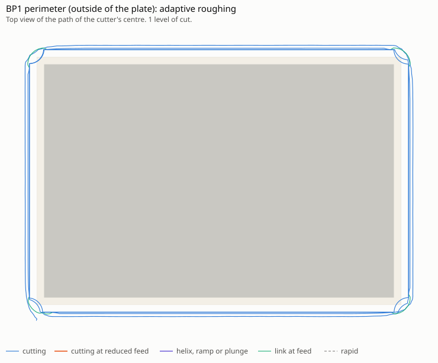

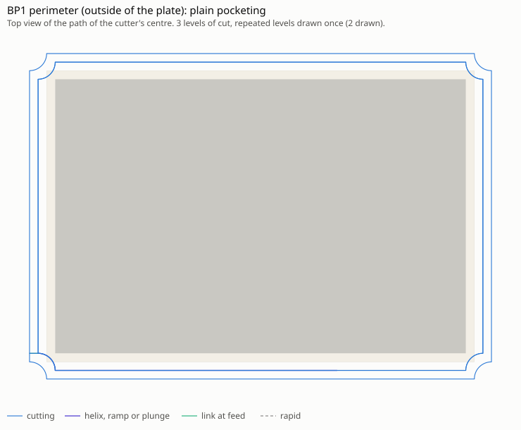

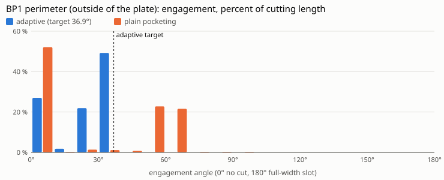

| Engagement band | under 2° (air) | 2-30° | 30-50° | 50-90° | 90-135° | 135-180° |
|-|-|-|-|-|-|-|
| adaptive | 2.0 % | 48.8 % | 49.2 % | 0.0 % | 0.0 % | 0.0 % |
| plain pocketing | 52.0 % | 1.7 % | 1.9 % | 44.4 % | 0.0 % | 0.0 % |

| Figure | Adaptive | Plain pocketing | Good is |
|-|-|-|-|
| Estimated time | 45.7 s | 181.6 s | adaptive below plain (75 % less) |
| Rapids, share of the estimated time | 1.0 % | 0.7 % | under 10 % (guide) |
| Path length: cutting / links at feed / rapids | 2.15 m / 0.09 m / 0.03 m | 3.60 m / 0.06 m / 0.14 m | |
| Links and rapids, share of the path length | 5.3 % | 5.3 % | |
| Levels (depths of cut) | 1 | 3 | |
| Median engagement (target 36.9°) | 25.5° **short** | 0.0° | within 2° of target |
| 99th-percentile engagement | 38.2° | 60.2° | at most 42.9° |
| the same, forward half of the cutter | 37.5° | | at most 42.9° |
| Largest reading (a spike) | 39.2° | 93.0° | see the two lines below |
| Cutting more than 10° over target | 0.00 % | | at most 0.5 % |
| Cutting above 1.5 x target | 0.00 % | | at most 0.1 % |
| Cutting above 90° | 0.00 % | 0.01 % | |
| Above 1.25 x target at full feed: whole cutter / forward half | 0.00 % / 0.00 % | | forward half 0.00 % |
| Cutting at reduced feed | 0.00 % | | |
| Air cutting | 2.0 % | 52.0 % | at most 15 % |
| Moves per mm | 0.13 | 0.02 | at most 1 |
| Corners sharper than 10° per metre of feed path | 8.2 | 1.8 | fewer is smoother |
| Reachable area left uncut | 0.00 mm² | 0.00 mm² | 0.00 mm² |
| Gouge into a wall | 4.1 µm | 0.5 µm | at most 10 µm |
| Material removed by links | 0.00 mm² | 0.00 mm² | 0.00 mm² (adaptive) |

Short: median engagement 25.5° against target 36.9°

Warnings the operations gave:

- Adaptive: no warnings.
- Plain pocketing: no warnings.

### BP1 two closed pockets (one operation)

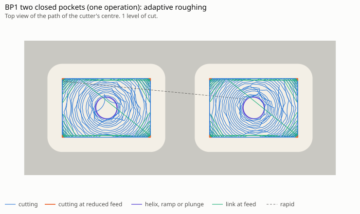

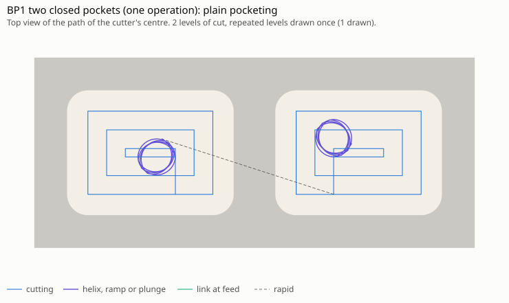

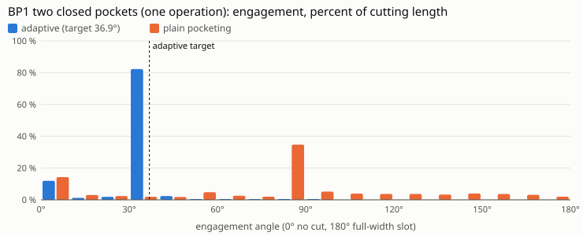

| Engagement band | under 2° (air) | 2-30° | 30-50° | 50-90° | 90-135° | 135-180° |
|-|-|-|-|-|-|-|
| adaptive | 1.6 % | 13.6 % | 84.6 % | 0.2 % | 0.0 % | 0.0 % |
| plain pocketing | 12.0 % | 7.7 % | 3.7 % | 44.2 % | 18.1 % | 14.2 % |

| Figure | Adaptive | Plain pocketing | Good is |
|-|-|-|-|
| Estimated time | 113.6 s **short** | 83.7 s | adaptive below plain (36 % more) |
| Rapids, share of the estimated time | 1.1 % | 2.5 % | under 10 % (guide) |
| Path length: cutting / links at feed / rapids | 3.24 m / 0.96 m / 0.11 m | 1.57 m / 0.05 m / 0.13 m | |
| Links and rapids, share of the path length | 25.0 % | 10.6 % | |
| Levels (depths of cut) | 1 | 2 | |
| Median engagement (target 36.9°) | 37.5° | 83.8° | within 2° of target |
| 99th-percentile engagement | 41.8° | 173.0° | at most 42.9° |
| the same, forward half of the cutter | 37.8° | | at most 42.9° |
| Largest reading (a spike) | 93.5° | 181.8° | see the two lines below |
| Cutting more than 10° over target | 0.37 % | | at most 0.5 % |
| Cutting above 1.5 x target | 0.12 % **short** | | at most 0.1 % |
| Cutting above 90° | 0.01 % | 32.33 % | |
| Above 1.25 x target at full feed: whole cutter / forward half | 0.35 % / 0.001 % **short** | | forward half 0.00 % |
| Cutting at reduced feed | 0.61 % | | |
| Air cutting | 1.6 % | 12.0 % | at most 10 % |
| Moves per mm | 0.58 | 0.06 | at most 1 |
| Corners sharper than 10° per metre of feed path | 89.9 | 49.8 | fewer is smoother |
| Reachable area left uncut | 0.00 mm² | 0.00 mm² | 0.00 mm² |
| Gouge into a wall | 0.0 µm | 0.5 µm | at most 10 µm |
| Material removed by links | 0.00 mm² | 0.00 mm² | 0.00 mm² (adaptive) |

Short: 0.12 % of cutting above 1.5 x target (limit 0.1 %); 0.001 % of cutting above 1.25 x target without reduced feed (forward half); estimated time 113.6 s, not below plain pocketing's 83.7 s

Warnings the operations gave:

- Adaptive: no warnings.
- Plain pocketing: no warnings.

### BP2 outside, first setup (1.25 in deep)

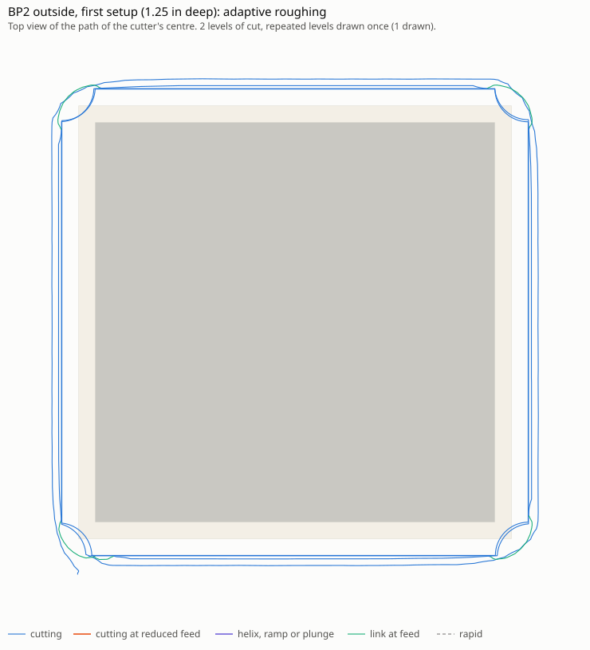

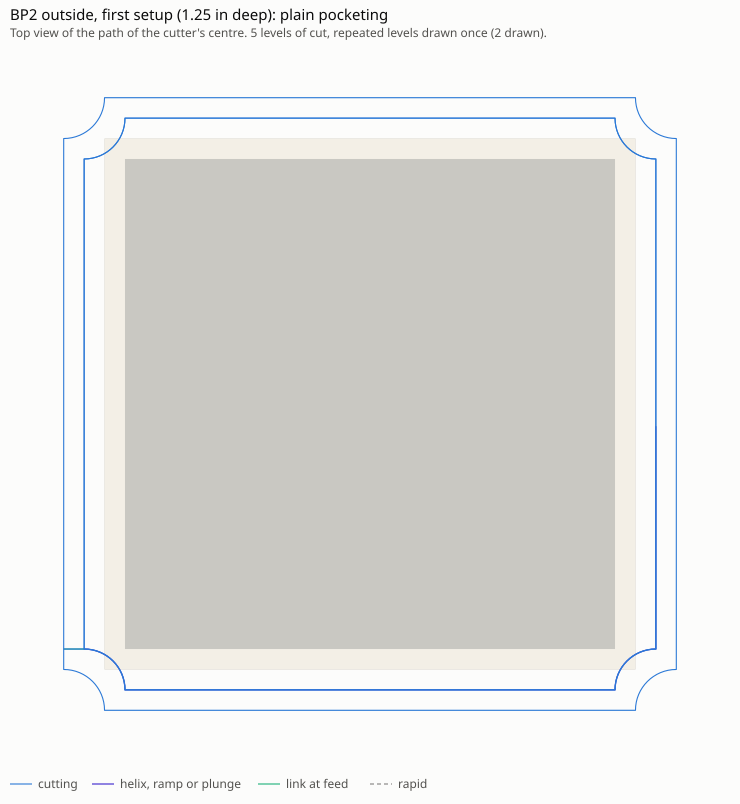

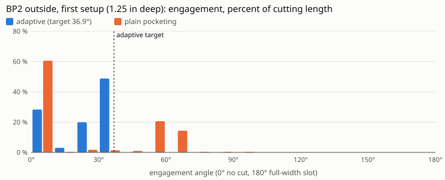

| Engagement band | under 2° (air) | 2-30° | 30-50° | 50-90° | 90-135° | 135-180° |
|-|-|-|-|-|-|-|
| adaptive | 3.2 % | 48.0 % | 48.8 % | 0.0 % | 0.0 % | 0.0 % |
| plain pocketing | 60.4 % | 2.2 % | 2.4 % | 35.0 % | 0.0 % | 0.0 % |

| Figure | Adaptive | Plain pocketing | Good is |
|-|-|-|-|
| Estimated time | 58.4 s | 206.7 s | adaptive below plain (72 % less) |
| Rapids, share of the estimated time | 0.8 % | 1.1 % | under 10 % (guide) |
| Path length: cutting / links at feed / rapids | 2.67 m / 0.19 m / 0.03 m | 3.97 m / 0.14 m / 0.23 m | |
| Links and rapids, share of the path length | 7.4 % | 8.5 % | |
| Levels (depths of cut) | 2 | 5 | |
| Median engagement (target 36.9°) | 24.8° **short** | 0.0° | within 2° of target |
| 99th-percentile engagement | 38.2° | 60.2° | at most 42.9° |
| the same, forward half of the cutter | 37.5° | | at most 42.9° |
| Largest reading (a spike) | 39.5° | 93.0° | see the two lines below |
| Cutting more than 10° over target | 0.00 % | | at most 0.5 % |
| Cutting above 1.5 x target | 0.00 % | | at most 0.1 % |
| Cutting above 90° | 0.00 % | 0.02 % | |
| Above 1.25 x target at full feed: whole cutter / forward half | 0.00 % / 0.00 % | | forward half 0.00 % |
| Cutting at reduced feed | 0.00 % | | |
| Air cutting | 3.2 % | 60.4 % | at most 15 % |
| Moves per mm | 0.18 | 0.03 | at most 1 |
| Corners sharper than 10° per metre of feed path | 11.5 | 2.8 | fewer is smoother |
| Reachable area left uncut | 0.00 mm² | 0.00 mm² | 0.00 mm² |
| Gouge into a wall | 4.1 µm | 2.0 µm | at most 10 µm |
| Material removed by links | 0.00 mm² | 0.00 mm² | 0.00 mm² (adaptive) |

Short: median engagement 24.8° against target 36.9°

Warnings the operations gave:

- Adaptive: no warnings.
- Plain pocketing: no warnings.

### BP2 open-sided step (0.5 in deep)

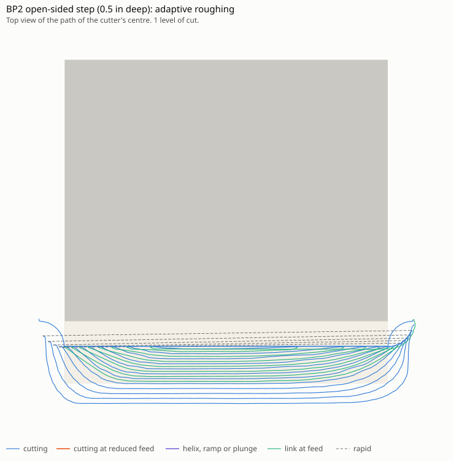

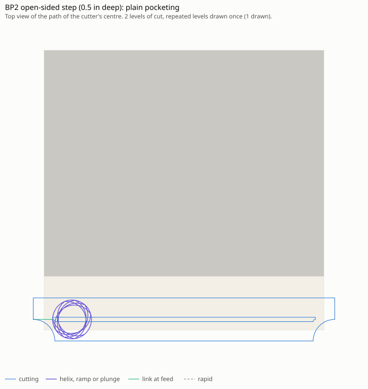

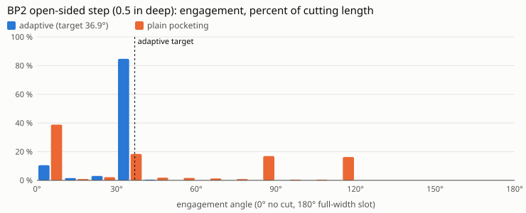

| Engagement band | under 2° (air) | 2-30° | 30-50° | 50-90° | 90-135° | 135-180° |
|-|-|-|-|-|-|-|
| adaptive | 2.7 % | 12.6 % | 84.7 % | 0.0 % | 0.0 % | 0.0 % |
| plain pocketing | 38.1 % | 3.9 % | 20.3 % | 20.8 % | 16.8 % | 0.0 % |

| Figure | Adaptive | Plain pocketing | Good is |
|-|-|-|-|
| Estimated time | 52.2 s | 55.1 s | adaptive below plain (5 % less) |
| Rapids, share of the estimated time | 9.8 % | 1.7 % | under 10 % (guide) |
| Path length: cutting / links at feed / rapids | 1.20 m / 0.76 m / 0.51 m | 1.04 m / 0.04 m / 0.05 m | |
| Links and rapids, share of the path length | 51.5 % | 8.1 % | |
| Levels (depths of cut) | 1 | 2 | |
| Median engagement (target 36.9°) | 36.2° | 36.2° | within 2° of target |
| 99th-percentile engagement | 38.5° | 114.5° | at most 42.9° |
| the same, forward half of the cutter | 37.5° | | at most 42.9° |
| Largest reading (a spike) | 41.2° | 114.5° | see the two lines below |
| Cutting more than 10° over target | 0.00 % | | at most 0.5 % |
| Cutting above 1.5 x target | 0.00 % | | at most 0.1 % |
| Cutting above 90° | 0.00 % | 16.84 % | |
| Above 1.25 x target at full feed: whole cutter / forward half | 0.00 % / 0.00 % | | forward half 0.00 % |
| Cutting at reduced feed | 0.00 % | | |
| Air cutting | 2.7 % | 38.1 % | at most 15 % |
| Moves per mm | 0.31 | 0.04 | at most 1 |
| Corners sharper than 10° per metre of feed path | 16.3 | 15.1 | fewer is smoother |
| Reachable area left uncut | 0.00 mm² | 0.00 mm² | 0.00 mm² |
| Gouge into a wall | 0.0 µm | 0.0 µm | at most 10 µm |
| Material removed by links | 0.00 mm² | 0.00 mm² | 0.00 mm² (adaptive) |

Short: none

Warnings the operations gave:

- Adaptive: no warnings.
- Plain pocketing: no warnings.

### BP2 circular pocket (1.500 in across, 0.75 in deep)

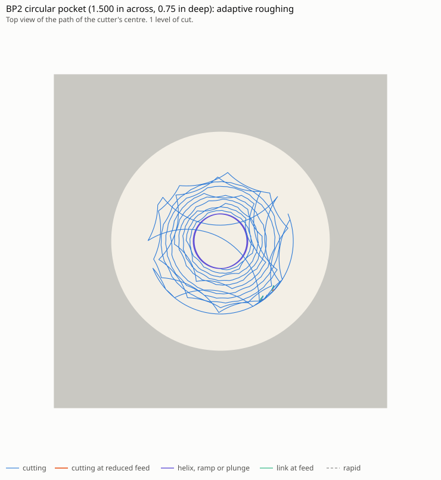

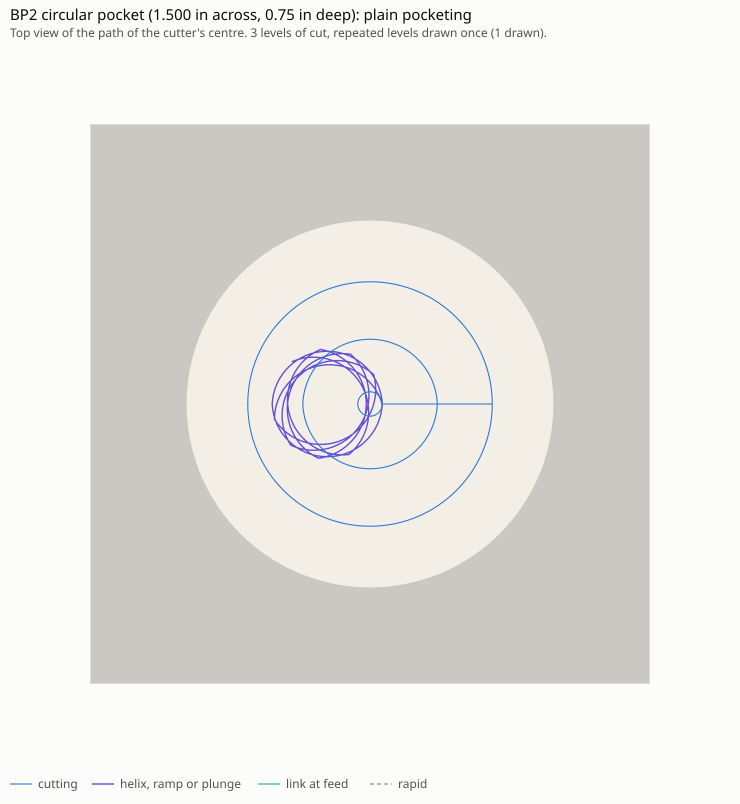

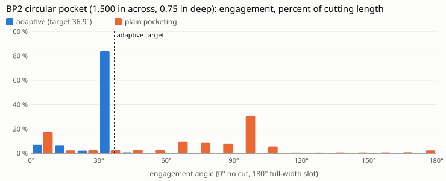

| Engagement band | under 2° (air) | 2-30° | 30-50° | 50-90° | 90-135° | 135-180° |
|-|-|-|-|-|-|-|
| adaptive | 0.6 % | 15.0 % | 84.4 % | 0.0 % | 0.0 % | 0.0 % |
| plain pocketing | 16.3 % | 6.6 % | 5.6 % | 29.2 % | 37.5 % | 4.9 % |

| Figure | Adaptive | Plain pocketing | Good is |
|-|-|-|-|
| Estimated time | 34.7 s | 52.0 s | adaptive below plain (33 % less) |
| Rapids, share of the estimated time | 1.3 % | 2.8 % | under 10 % (guide) |
| Path length: cutting / links at feed / rapids | 1.11 m / 0.03 m / 0.03 m | 0.93 m / 0.07 m / 0.08 m | |
| Links and rapids, share of the path length | 4.4 % | 13.7 % | |
| Levels (depths of cut) | 1 | 3 | |
| Median engagement (target 36.9°) | 37.5° | 80.5° | within 2° of target |
| 99th-percentile engagement | 39.8° | 179.0° | at most 42.9° |
| the same, forward half of the cutter | 38.0° | | at most 42.9° |
| Largest reading (a spike) | 44.8° | 181.2° | see the two lines below |
| Cutting more than 10° over target | 0.00 % | | at most 0.5 % |
| Cutting above 1.5 x target | 0.00 % | | at most 0.1 % |
| Cutting above 90° | 0.00 % | 42.38 % | |
| Above 1.25 x target at full feed: whole cutter / forward half | 0.00 % / 0.00 % | | forward half 0.00 % |
| Cutting at reduced feed | 0.09 % | | |
| Air cutting | 0.6 % | 16.3 % | at most 10 % |
| Moves per mm | 0.43 | 0.06 | at most 1 |
| Corners sharper than 10° per metre of feed path | 12.2 | 22.3 | fewer is smoother |
| Reachable area left uncut | 0.00 mm² | 0.00 mm² | 0.00 mm² |
| Gouge into a wall | 0.0 µm | 0.5 µm | at most 10 µm |
| Material removed by links | 0.00 mm² | 0.00 mm² | 0.00 mm² (adaptive) |

Short: none

Warnings the operations gave:

- Adaptive: no warnings.
- Plain pocketing: no warnings.

### BP2 outside, second setup (the remaining 0.75 in)

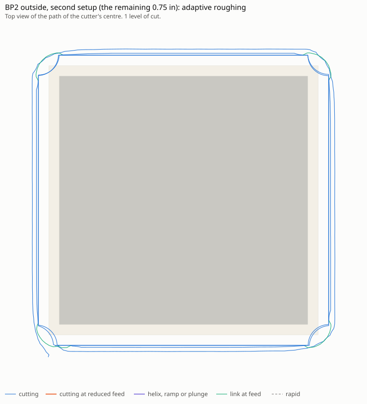

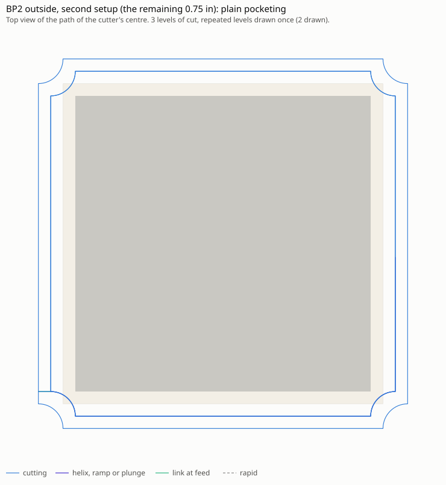

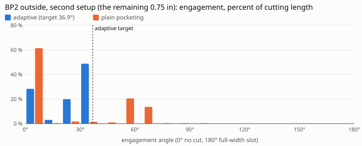

| Engagement band | under 2° (air) | 2-30° | 30-50° | 50-90° | 90-135° | 135-180° |
|-|-|-|-|-|-|-|
| adaptive | 3.2 % | 48.0 % | 48.8 % | 0.0 % | 0.0 % | 0.0 % |
| plain pocketing | 61.2 % | 2.2 % | 2.4 % | 34.2 % | 0.0 % | 0.0 % |

| Figure | Adaptive | Plain pocketing | Good is |
|-|-|-|-|
| Estimated time | 30.5 s | 123.8 s | adaptive below plain (75 % less) |
| Rapids, share of the estimated time | 1.5 % | 1.1 % | under 10 % (guide) |
| Path length: cutting / links at feed / rapids | 1.34 m / 0.10 m / 0.03 m | 2.41 m / 0.06 m / 0.13 m | |
| Links and rapids, share of the path length | 8.6 % | 7.4 % | |
| Levels (depths of cut) | 1 | 3 | |
| Median engagement (target 36.9°) | 24.8° **short** | 0.0° | within 2° of target |
| 99th-percentile engagement | 38.2° | 60.2° | at most 42.9° |
| the same, forward half of the cutter | 37.5° | | at most 42.9° |
| Largest reading (a spike) | 39.5° | 93.0° | see the two lines below |
| Cutting more than 10° over target | 0.00 % | | at most 0.5 % |
| Cutting above 1.5 x target | 0.00 % | | at most 0.1 % |
| Cutting above 90° | 0.00 % | 0.01 % | |
| Above 1.25 x target at full feed: whole cutter / forward half | 0.00 % / 0.00 % | | forward half 0.00 % |
| Cutting at reduced feed | 0.00 % | | |
| Air cutting | 3.2 % | 61.2 % | at most 15 % |
| Moves per mm | 0.18 | 0.03 | at most 1 |
| Corners sharper than 10° per metre of feed path | 11.5 | 2.8 | fewer is smoother |
| Reachable area left uncut | 0.00 mm² | 0.00 mm² | 0.00 mm² |
| Gouge into a wall | 4.1 µm | 2.0 µm | at most 10 µm |
| Material removed by links | 0.00 mm² | 0.00 mm² | 0.00 mm² (adaptive) |

Short: median engagement 24.8° against target 36.9°

Warnings the operations gave:

- Adaptive: no warnings.
- Plain pocketing: no warnings.

### BP3 stepped profile (0.90 in deep)

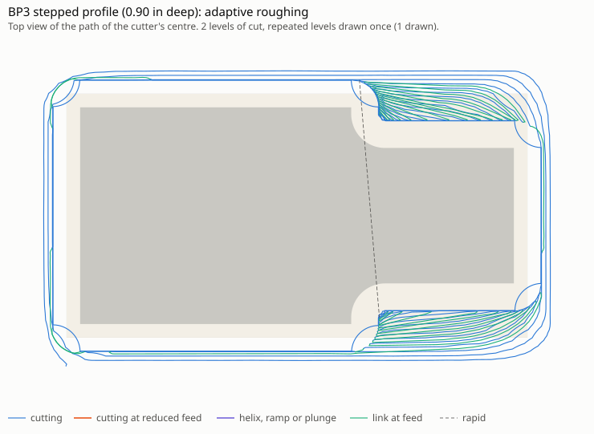

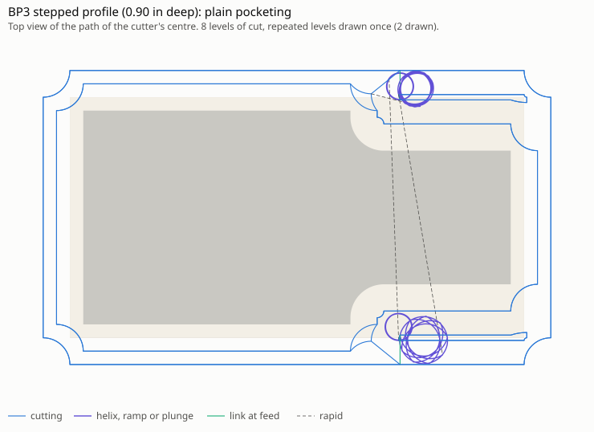

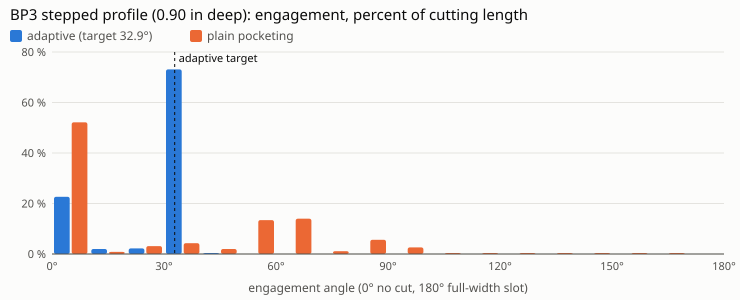

| Engagement band | under 2° (air) | 2-30° | 30-50° | 50-90° | 90-135° | 135-180° |
|-|-|-|-|-|-|-|
| adaptive | 3.5 % | 23.5 % | 73.0 % | 0.0 % | 0.0 % | 0.0 % |
| plain pocketing | 51.7 % | 4.5 % | 6.2 % | 34.1 % | 3.1 % | 0.3 % |

| Figure | Adaptive | Plain pocketing | Good is |
|-|-|-|-|
| Estimated time | 808.3 s | 3478.5 s | adaptive below plain (77 % less) |
| Rapids, share of the estimated time | 0.3 % | 0.3 % | under 10 % (guide) |
| Path length: cutting / links at feed / rapids | 4.43 m / 1.79 m / 0.25 m | 9.22 m / 0.48 m / 0.68 m | |
| Links and rapids, share of the path length | 31.5 % | 11.2 % | |
| Levels (depths of cut) | 2 | 8 | |
| Median engagement (target 32.9°) | 32.2° | 0.0° | within 2° of target |
| 99th-percentile engagement | 35.5° | 98.2° | at most 38.9° |
| the same, forward half of the cutter | 33.2° | | at most 38.9° |
| Largest reading (a spike) | 41.0° | 160.5° | see the two lines below |
| Cutting more than 10° over target | 0.00 % | | at most 0.5 % |
| Cutting above 1.5 x target | 0.00 % | | at most 0.1 % |
| Cutting above 90° | 0.00 % | 3.46 % | |
| Above 1.25 x target at full feed: whole cutter / forward half | 0.00 % / 0.00 % | | forward half 0.00 % |
| Cutting at reduced feed | 0.00 % | | |
| Air cutting | 3.5 % | 51.7 % | at most 15 % |
| Moves per mm | 0.30 | 0.05 | at most 1 |
| Corners sharper than 10° per metre of feed path | 34.7 | 8.9 | fewer is smoother |
| Reachable area left uncut | 0.00 mm² | 0.00 mm² | 0.00 mm² |
| Gouge into a wall | 2.0 µm | 0.5 µm | at most 10 µm |
| Material removed by links | 0.00 mm² | 0.00 mm² | 0.00 mm² (adaptive) |

Short: none

Warnings the operations gave:

- Adaptive: no warnings.
- Plain pocketing: no warnings.

### BP3 through slot (0.375 in wide, 0.90 in deep)

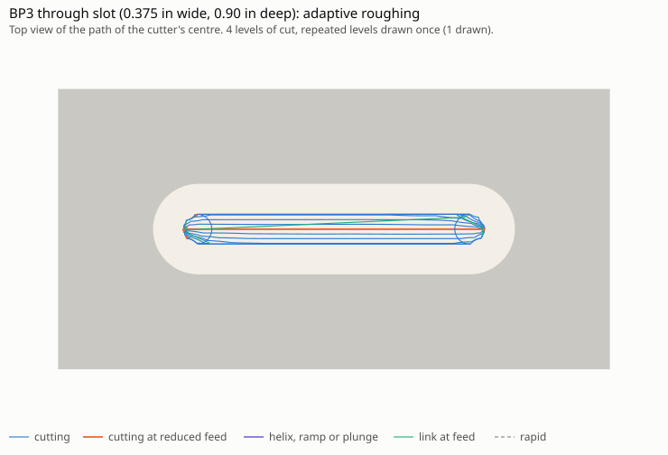

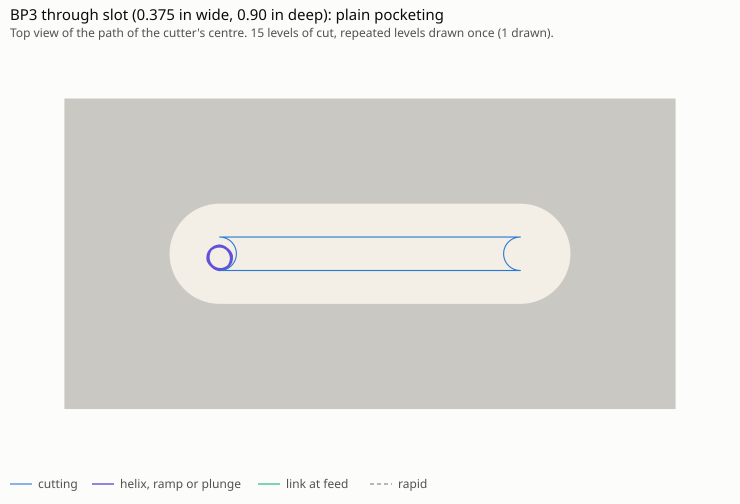

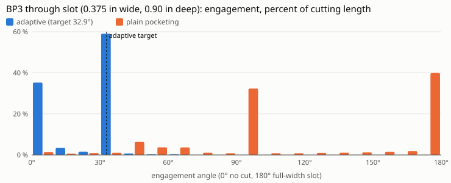

| Engagement band | under 2° (air) | 2-30° | 30-50° | 50-90° | 90-135° | 135-180° |
|-|-|-|-|-|-|-|
| adaptive | 12.3 % | 28.2 % | 59.4 % | 0.1 % | 0.0 % | 0.0 % |
| plain pocketing | 1.2 % | 1.8 % | 7.5 % | 9.1 % | 35.4 % | 45.1 % |

| Figure | Adaptive | Plain pocketing | Good is |
|-|-|-|-|
| Estimated time | 582.2 s | 1008.5 s | adaptive below plain (42 % less) |
| Rapids, share of the estimated time | 0.1 % | 0.4 % | under 10 % (guide) |
| Path length: cutting / links at feed / rapids | 2.50 m / 0.20 m / 0.03 m | 2.28 m / 0.40 m / 0.13 m | |
| Links and rapids, share of the path length | 8.4 % | 18.7 % | |
| Levels (depths of cut) | 4 | 15 | |
| Median engagement (target 32.9°) | 31.0° | 90.8° | within 2° of target |
| 99th-percentile engagement | 39.0° **short** | 179.8° | at most 38.9° |
| the same, forward half of the cutter | 32.5° | | at most 38.9° |
| Largest reading (a spike) | 63.0° | 182.5° | see the two lines below |
| Cutting more than 10° over target | 0.19 % | | at most 0.5 % |
| Cutting above 1.5 x target | 0.06 % | | at most 0.1 % |
| Cutting above 90° | 0.00 % | 80.45 % | |
| Above 1.25 x target at full feed: whole cutter / forward half | 0.36 % / 0.00 % | | forward half 0.00 % |
| Cutting at reduced feed | 0.81 % | | |
| Air cutting | 12.3 % | 1.2 % | at most 15 % |
| Moves per mm | 0.39 | 0.06 | at most 1 |
| Corners sharper than 10° per metre of feed path | 120.6 | 0.0 | fewer is smoother |
| Reachable area left uncut | 0.00 mm² | 0.00 mm² | 0.00 mm² |
| Gouge into a wall | 0.0 µm | 0.5 µm | at most 10 µm |
| Material removed by links | 0.00 mm² | 0.00 mm² | 0.00 mm² (adaptive) |

Short: 99th-percentile engagement 39.0° against 38.9°

Warnings the operations gave:

- Adaptive: At Z19.685, Z13.97, Z8.255 and Z2.54: the area around X31.75 Y25.401 is entered by a ramp: a helix of 4.762 mm does not fit
- Plain pocketing: no warnings.

## The reference case behind known issues (a) and (b)

Spike S5's islands pocket (90 x 60 mm, a round island and a rounded-rectangle island) with a 12.7 mm cutter at 10 %
load, measured exactly as the engine's own acceptance tests measure it: target 36.9°, median 38.0°,
p99 44.0° (limit 42.9°), p99 on the forward half 39.0°; cutting read above 1.25 times the target
at full feed 0.11 % on the whole cutter and 0.00 % on the forward half; cutting at
reduced feed 0.04 %.

## What the estimates assume

The cycle-time model (src/cam/cycletime.cpp) times every move with a trapezoidal speed profile, holds feeds under
the machine's limits, stops at corners sharper than 10° and runs through gentler ones, and leaves out the tool
change. What the machine definitions do not say, it assumes, and says so:

- Haas VF-2 class (BP1): The machine's axis accelerations are not known: 1000 mm/s^2 was assumed.
- Mazak VC-Ez 20 class (BP2): The machine's axis accelerations are not known: 1000 mm/s^2 was assumed. The machine's rapid rates are not known: 10000 mm/min was assumed. The machine's maximum feeds are not known: feeds were held to the rapid rate.
- Fanuc ROBODRILL class (BP3): The machine's axis accelerations are not known: 1000 mm/s^2 was assumed.

A slow assumed acceleration penalises the strategy with more direction changes, which is adaptive roughing; how much
is not known until the times are measured on a machine.

## Not verified

- Nothing here was cut on a machine; the times are the model's estimates for both strategies.
- The cutting data are the starter library's conservative generic values, not a cutter maker's data, and the feeds
  calculator's chip-thinning correction has not been checked against cutting tests.
- Dimensions the plan does not give were chosen here (see "The parts as modelled").
- The checker's readings carry its own error: about 1° on straight cuts, a little more on arcs, and more in tight
  turns, which is why the forward-half reading is given beside the whole-cutter one.
- The checker works in 2D, one level at a time, each level starting from full material. A helix is swept as one
  circle at the level and not measured. A ramp's zigzag is not swept; the cut along the ramp's line at the level that
  follows it is swept as part of the entry and not measured (a full-width cut at reduced feed), as the engine's own
  acceptance counts it.
- Run times of the generation are not part of the generated figures. The ones in known issue (d) were measured once,
  alone on the development machine; other work runs on that machine at other times, so a single reading can be off
  by up to a factor of two.
- The generator was run on Windows only; on another system the last digit of a few readings may differ (the test
  allows that).

## How this report is made

`tests/benchmarks/adaptive/review_pack_test.cpp` models the parts, runs both operations, measures each toolpath with
the sweep checker (`tests/tools/sweepcheck`) and the cycle-time model, draws the pictures and fills this template
(`tests/benchmarks/adaptive/report.md.in`). Run `ray_bench_adaptive_review "[write]"` to rebuild the report and the
pictures; the CTest test `ray_bench_adaptive_review` (slow tier) fails when they are out of date or a field is
missing.
